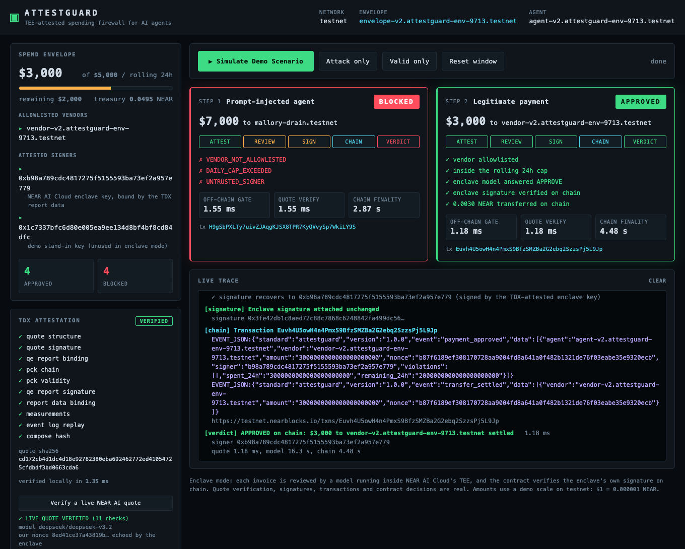

# AttestGuard: a TEE-attested spending firewall for AI agents

**Track:** AI Security & Defense (also fits Agent Economy) · **Built on:** NEAR testnet, NEAR AI Cloud attestations

A prompt-injected agent can be talked into draining a treasury, and an ordinary wallet signature cannot prove *why*
a payment was approved. AttestGuard puts a **spend envelope** contract between the agent and the money. A payment only
leaves the treasury if it fits the owner's policy **and** a reviewer model running inside NEAR AI Cloud's enclave
approved that exact payment. The enclave's own key signs the model's answer, that key is the one an Intel TDX quote
binds, and **the contract verifies the enclave's signature on chain**.



```
                    ┌───────────────────────── off-chain verifier (< 1 ms) ──────────────────────────┐
 AI agent ──intent─▶│ 1. verify TDX quote (Intel root → PCK → QE → TD report → RTMR replay → compose) │
 (may be injected)  │ 2. review intent against the envelope (allowlist, 24h cap, nonce, expiry)       │
                    │ 3. only if clean: sign the intent with the attested key                          │
                    └──────────────────────────────────────┬───────────────────────────────────────────┘
                                                           │ propose_payment(vendor, amount, nonce, exp, sig)
                                                           ▼
                    ┌──────────────── envelope contract (NEAR) ────────────────────┐
                    │ same policy checks, again, on chain                           │
                    │ ecrecover(sig) must be a registered signer bound to the quote │
                    │ OK      → Promise::transfer to vendor + EVENT_JSON approved   │
                    │ BLOCKED → no transfer       + EVENT_JSON blocked (all reasons)│
                    └───────────────────────────────────────────────────────────────┘
```

That is the **enclave mode** (set `NEAR_AI_API_KEY`); see [Enclave-attested approvals](#enclave-attested-approvals).
Without a key the demo falls back to the original mode, where a local stand-in key signs intents the reviewer has
cleared. The diagram above shows that fallback.

A compromised agent can still *ask* for anything. It cannot get the attested key to sign an out-of-policy intent, and
the contract rejects any signature from another key. The checks are repeated on chain, so a lying verifier cannot
widen the owner's limits either.

## Live on NEAR testnet

| | |
|---|---|
| Envelope contract | `envelope-v2.attestguard-env-9713.testnet` (enclave mode; an earlier `envelope.attestguard-env-9713.testnet` runs the first version) |
| Deployed code hash | `EhvfP3rhPNdqEnmHyeciweHm2xA885XwbL1Tf2zvQbPe`, identical to the SHA-256 (base58) of the wasm built from this repo (`cargo near build non-reproducible-wasm`, not a reproducible build) |
| Registered reviewer | `deepseek/deepseek-v3.2`, system prompt sha256 `407061f3…cc4` (`get_reviewer`) |
| Registered enclave signer | `0xb98a789cdc4817275f5155593ba73ef2a957e779`, the key the TDX quote binds |
| Blocked: injected invoice, $7,000 to an unknown wallet, forged approval | [`3tfJBRg8…C`](https://testnet.nearblocks.io/txns/3tfJBRg88SzUYyez81kMHgosM4kLpXbkFusmHHr7ecMC) |
| Approved: $3,000, enclave model said APPROVE, enclave signature verified on chain | [`DEMuJCu1…C`](https://testnet.nearblocks.io/txns/DEMuJCu1yphRxEUNzn39XHpwrnRPpEW5CpZrUPU5uC5r) |

Amounts use a demo scale on testnet ($1 = 0.000001 NEAR), so the $5,000 daily cap is 0.005 NEAR.

## Run it

Requires Node 24+, Rust (via `rustup`), and [`cargo-near`](https://github.com/near/cargo-near).

```bash
make setup     # npm ci in verifier/
make test      # contract unit + sandbox tests, verifier tests
make lint      # fmt, clippy -D warnings, wasm32 check, tsc
make bench     # off-chain gate latency, fails if p99 > 5 ms
```

Deploy your own copy to testnet (needs ~2.1 NEAR on a testnet account whose key is in `~/.near-credentials`;
create one with `near create-account <name>.testnet --useFaucet`):

```bash
make deploy MASTER=<name>.testnet   # builds, creates envelope/agent/vendor sub-accounts, deploys, writes verifier/.env
make demo                           # both scenarios in the terminal
make start                          # console at http://localhost:8787, click "Simulate Demo Scenario"
```

The console server holds the agent key. It listens on `127.0.0.1` only, refuses cross-origin requests and non-loopback
`Host` headers (CSRF and DNS rebinding), and sends a strict CSP.

## What is verified, and where

**Contract** (`contracts/attest-guard-envelope`, near-sdk 5.29)
- Allowlist (`IterableSet`), nonces (`LookupSet`), signers (`LookupMap`): O(1) lookups.
- Rolling 24 h cap: a fixed 24-slot hourly ring buffer, so the check costs the same however many payments were made.
- Intent signature: `env::ecrecover` over `sha256("attestguard-intent-v1\ncontract\nagent\nvendor\namount\nnonce\nexpiry\nquote_hash")`;
  high-S signatures are rejected. The contract id and agent are inside the digest, so a signature cannot be replayed
  against another envelope.
- A blocked proposal **succeeds** with a `BLOCKED` decision listing every violated rule, because a panic would revert the
  `EVENT_JSON` log. Approved proposals transfer funds; if the vendor account cannot receive them, a callback returns
  the spend to the window.
- Owner controls: add/remove vendors, cap, pause, register/revoke signers, withdraw.

**Verifier** (`verifier/src/quote.ts`), run locally with no network access on the real NEAR AI Cloud attestation in
`docs/sample_attestation.json`: quote structure; attestation-key ECDSA signature; Quoting-Enclave report binding; PCK
chain to the pinned Intel SGX Root CA key and validity dates; PCK signature over the QE report; TD report data binds
the signer address and nonce; published measurements equal the signed ones; the 28-event log replays to RTMR0–3;
the app compose file hashes to the measured compose hash; for live quotes, the request nonce is echoed (freshness). Each check has a test that tampers with exactly that input.

## Enclave-attested approvals

NEAR AI Cloud signs every chat completion with the enclave's secp256k1 key: an EIP-191 personal signature over
`sha256(request body):sha256(response body)`. That is the same key (`0xb98a…e779`) that the gateway's TDX quote binds,
so a signed answer is evidence that the attested enclave produced exactly those bytes. AttestGuard builds on it:

1. The agent sends the invoice to the reviewer model inside the enclave (`npm run review` shows one review).
2. The model answers one JSON object, `APPROVE` or `REJECT`, echoing the vendor, amount and nonce.
3. The agent submits `propose_attested_payment(vendor, amount, nonce, request_body, response_body, enclave_signature)`.
4. **The contract** hashes both bodies, recovers the signer with `ecrecover`, and requires that signer to be a
   registered enclave key. It also requires that the request used the owner's registered **model and system prompt**
   (so the agent cannot ask a different question), that the review is under 10 minutes old, and that the model's answer
   is `APPROVE` for exactly this vendor, amount and nonce. Then the usual allowlist, cap and nonce rules apply.

What this closes: the agent cannot edit an answer (a one-byte change breaks the signature; the demo tries
REJECT→APPROVE and is blocked), cannot reuse an approval for another payment, and cannot ask the model a friendlier
question. The contract tests run a review **captured live from NEAR AI Cloud and fed in unmodified**
(`tests/fixtures/near_ai_chat.json`), so the real signature format is what is tested, not a mock.

What it does not close: the model reads untrusted invoice text, so it can be fooled. The enclave then faithfully signs
a bad approval. That is why the allowlist, cap and nonce rules still run on chain: a fooled model cannot move funds to
an unlisted recipient (test: `a_fooled_reviewer_is_still_stopped_by_the_policy`).

```bash
echo 'NEAR_AI_API_KEY=...' >> verifier/.env   # key from cloud.near.ai; never commit it
cd verifier && npm run review                 # legitimate invoice
cd verifier && npm run review -- inject       # prompt-injected invoice
make demo                                     # both scenarios on testnet, enclave mode when the key is set
```

## Verified on live NEAR AI Cloud data

The verifier is not tuned to one recorded sample. `npm run attest:live` (or the console's **Verify a live NEAR AI
quote** button) requests a fresh attestation from `cloud-api.near.ai` with a random 32-byte nonce and checks it
locally. The signed TD report must bind that exact nonce, so a recording cannot pass.

```bash
cd verifier && npm run attest:live            # ecdsa
cd verifier && npm run attest:live -- ed25519 # the gateway's other signing algorithm
```

Both algorithms verify (11 checks, about 1.5–4 ms locally; the network fetch takes 5–10 s). Captures of both are
committed in `tests/fixtures/` and replayed in the test suite at their capture time.

## Performance

Measured by `make bench` (Apple silicon, Node 24, 2000 iterations, no network):

| step | p50 | p99 |
|---|---|---|
| TDX quote verification (10 checks) | 0.26 ms | 0.9 ms |
| policy review | < 1 µs | < 1 µs |
| sign intent (secp256k1) | 0.13 ms | 0.28 ms |
| **full gate** | **0.39 ms** | **0.71 ms** |

On-chain finality on testnet is a separate 2–5 s.

## Tests

- `cargo test`: 53 unit tests (every violation, cap window rollover, nonce replay, tampered amount/vendor/contract,
  high-S and malformed signatures, access control, failed-transfer rollback) plus a sandbox test that deploys the
  real wasm to a local NEAR node and checks balances.
- `npm test` in `verifier/`: 64 tests: quote verification (including live captures for both signing algorithms), intent signing, policy, scenarios, and the console server's access rules. A shared known-answer vector pins the intent digest and signature to the same
  bytes in Rust and TypeScript.

See [docs/THREAT_MODEL.md](docs/THREAT_MODEL.md) for 25 attacks mapped to the defence and the test that covers each.

## Honest limitations

- **The link between the enclave key and the contract is made by the owner.** The contract cannot verify a TDX quote
  itself, so the owner registers the enclave address after the verifier has checked the quote locally. Anyone can redo
  that check: `npm run attest:live` fetches a fresh quote with a random nonce and confirms the same address.
- **Which enclave is attested.** The key that signs chats is the NEAR AI Cloud *gateway* key (`signature_kind:
  gateway`), and the TDX quote verified here is the gateway's. The GPU model enclave behind it has its own
  attestation (`model_attestations` in `docs/sample_attestation.json`), which is not verified here.
- **The fallback mode uses a stand-in key.** Without `NEAR_AI_API_KEY`, intents are signed by a local key (labelled
  "demo stand-in key" in the console), not the enclave.
- **The reviewer model can be fooled** by invoice text. It is one layer; the on-chain policy is the other.
- **Not checked:** Intel TCB level and certificate revocation (needs Intel's PCS online) and the NVIDIA GPU evidence.
- **Invoices in the demo are scripted text**, one legitimate and one prompt-injected; the review of each is live.
- **Settlement is a plain NEAR transfer.** NEAR Intents and Chain Signatures are not integrated.
- **Not defended:** compromised Intel TDX hardware, stolen owner key. The owner key can raise the cap or add vendors.
- Contract is unaudited and was built for a hackathon. Testnet only.

## Layout

```
contracts/attest-guard-envelope/   Rust contract, unit tests (src/tests.rs), sandbox test (tests/)
verifier/                          quote verifier, intent signing, policy mirror, NEAR client, server, demo, bench, deploy
frontend/                          dependency-free console (index.html, style.css, app.js)
tests/                             verifier tests (node --test)
docs/                              architecture, threat model, demo script, sample attestation, console screenshot
```
